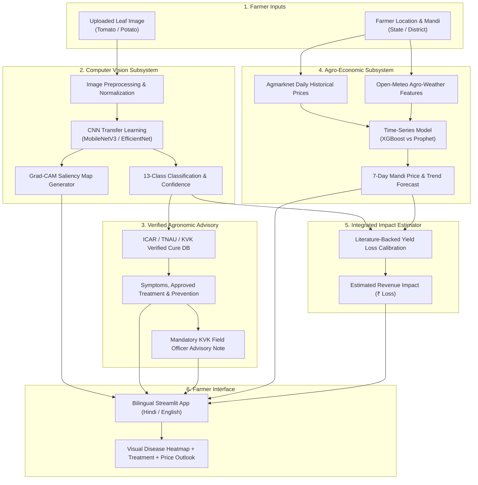

# KisanMitra AI (किसान मित्र AI)

> **An End-to-End Decision Support System for Indian Potato and Tomato Farmers Combining Deep Learning Vision and Agro-Economic Forecasting.**

---

## 1. Problem Statement

Smallholder farmers in India face two compounding vulnerabilities that severely threaten their livelihoods:

1. **Crop Disease Outbreaks:** Tomato and potato crops are highly susceptible to fungal, bacterial, and viral diseases such as Late Blight (*Phytophthora infestans*) and Tomato Yellow Leaf Curl Virus (TYLCV). Late Blight alone can wipe out 40% to 100% of potato crops within days if left undetected. Farmers frequently lack immediate access to certified agronomists, resulting in delayed treatments, incorrect pesticide misuse, and catastrophic yield losses.
2. **Extreme Mandi Price Volatility:** Perishable vegetables like tomato and potato experience violent price fluctuations in local agricultural markets (APMC mandis). Farmers often sell during severe market gluts at below-production costs or miss optimal harvest windows because they lack forward-looking market intelligence and weather correlation.
3. **Information & Language Disconnect:** Existing agricultural portals are fragmented, desktop-oriented, presented in complex English, or lack scientific accountability. Farmers require actionable, verified advice in their native language (starting with Hindi) with clear, trustworthy estimates of disease-related financial impact.

**KisanMitra AI** bridges this gap by unifying leaf disease diagnosis (with visual Grad-CAM explainability and ICAR-verified treatments) with mandi price and yield forecasting in an accessible bilingual web platform.

---

## 2. Planned Features

- **Leaf Disease Diagnostic Engine:**
  - Real-time image classification for **13 distinct PlantVillage classes** across tomato and potato.
  - Transfer learning with lightweight Convolutional Neural Networks (**MobileNetV3** / **EfficientNet**).
  - **Grad-CAM (Gradient-weighted Class Activation Mapping)** heatmaps to visually explain *why* the model made a diagnosis and pinpoint diseased leaf regions.
- **Scientifically Verified Cure & Advisory Database:**
  - Direct mapping of symptoms, ICAR/TNAU/KVK-verified chemical and organic treatments, and preventive measures.
  - **Zero hallucination guarantee:** No unverified commercial formulations; every recommendation cites an official agronomic authority.
  - Prominent mandatory advisory note: *"Please confirm with a local agriculture officer / KVK before spraying."*
- **Mandi Price & Crop Yield Forecasting:**
  - Mandi modal price forecasting using official Agmarknet / data.gov.in daily historical records.
  - Ingestion of local agro-meteorological indicators (temperature, rainfall, humidity) via the **Open-Meteo API**.
  - Time-series modeling comparing **XGBoost Regressor** against **Prophet / LSTM**, evaluated on strict **time-based validation splits**.
- **Unified Economic Impact Assessment:**
  - Bridges vision and economics: when a disease is identified, the system calculates estimated crop loss percentage and translates it into estimated income loss at current forecasted market rates.
- **Bilingual Farmer-Centric Interface:**
  - Interactive **Streamlit** application designed for mobile and low-bandwidth web access.
  - Complete Hindi language support (text first, voice integration planned).
- **Production-Ready Deployment:**
  - Containerized with **Docker** for reproducibility and deployment on Hugging Face Spaces or Render.

---

## 3. System Architecture Outline



---

## 4. Target Classes (PlantVillage - 13 Classes)

### Potato (3 Classes)
1. `Potato___Early_blight` (*Alternaria solani*)
2. `Potato___Late_blight` (*Phytophthora infestans*)
3. `Potato___healthy`

### Tomato (10 Classes)
1. `Tomato___Bacterial_spot` (*Xanthomonas campestris*)
2. `Tomato___Early_blight` (*Alternaria solani*)
3. `Tomato___Late_blight` (*Phytophthora infestans*)
4. `Tomato___Leaf_Mold` (*Passalora fulva*)
5. `Tomato___Septoria_leaf_spot` (*Septoria lycopersici*)
6. `Tomato___Spider_mites Two-spotted_spider_mite` (*Tetranychus urticae*)
7. `Tomato___Target_Spot` (*Corynespora cassiicola*)
8. `Tomato___Tomato_Yellow_Leaf_Curl_Virus` (TYLCV)
9. `Tomato___Tomato_mosaic_virus` (ToMV)
10. `Tomato___healthy`

---

## 5. Technology Stack

- **Deep Learning & Computer Vision:** PyTorch, Torchvision, PyTorch-Grad-CAM, OpenCV, Pillow
- **Tabular ML & Time Series:** Scikit-Learn, XGBoost, Prophet, Statsmodels, Pandas, NumPy
- **Agro-Weather Integration:** Open-Meteo API, Requests, Requests-Cache
- **Experiment Tracking:** MLflow
- **Web Interface:** Streamlit (bilingual UI support)
- **Deployment & DevOps:** Docker, Hugging Face Spaces / Render, GitHub Actions

---

## 6. Directory Structure

```text
Aikissan/
├── data/
│   ├── raw/             # Original datasets (PlantVillage raw, Agmarknet CSVs)
│   └── processed/       # Preprocessed images, cleaned tabular series, cure database
├── notebooks/           # Jupyter exploratory notebooks for Colab / Kaggle
├── src/
│   ├── __init__.py
│   ├── disease/         # CNN dataset loaders, training loop, inference, Grad-CAM
│   ├── price/           # Agmarknet ingestion, weather client, feature engineering, forecasting
│   └── utils/           # Shared device helpers, metric loggers, validators
├── models/              # Exported model weights (*.pt, *.json, *.joblib)
├── app/                 # Streamlit application components and localization
├── reports/             # Resume metrics (results.md), confusion matrices, and figures
├── tests/               # Pytest unit tests for sanity, models, and pipeline integrity
├── .env.example         # Template for environment variables and secrets
├── .gitignore           # Git ignore rules for data, weights, and caches
├── requirements.txt     # Python package dependencies
└── README.md            # Project documentation
```

---

## 7. How to Run (Local Quickstart)

*(This section will be expanded as modules are implemented across phases.)*

### 1. Clone Repository & Setup Virtual Environment
```bash
git clone https://github.com/namangoyal176-10/Aikissan.git
cd Aikissan

# Create and activate Python virtual environment
python3 -m venv .venv
source .venv/bin/activate  # On Windows: .venv\Scripts\activate

# Install dependencies
pip install --upgrade pip
pip install -r requirements.txt
```

### 2. Configure Environment Variables
```bash
cp .env.example .env
# Edit .env with your environment configuration
```

### 3. Run Phase 2 Data Pipeline

#### A. Disease Dataset Preparation (PlantVillage)
Download the 13 Potato and Tomato folders from Kaggle into `data/raw/plantvillage/`, then run:
```bash
python3 src/disease/prepare_dataset.py
```
This performs a stratified 70/15/15 train/val/test split and generates manifest CSVs in `data/processed/`.

#### B. Weather & Mandi Price Pipeline
Fetch daily weather from Open-Meteo and standardize Agmarknet mandi prices:
```bash
# 1. Ingest Agmarknet price series (from data/raw/agmarknet/ or data.gov.in API)
python3 src/price/fetch_agmarknet.py

# 2. Fetch agro-meteorological observations from Open-Meteo
python3 src/price/fetch_weather.py --start-date 2022-01-01 --end-date 2024-01-01

# 3. Merge price and weather datasets and print Data Quality Report
python3 src/price/merge_data.py
```

### 4. Run Unit Tests
```bash
python3 -m unittest discover tests -v
# or with pytest
pytest tests/ -v
```

---

## 8. Limitations & Ethical Safeguards

1. **Lab vs. Field Domain Gap:** PlantVillage dataset images are captured under controlled lighting against uniform backgrounds. Real farm conditions involve direct sunlight, shadow occlusions, multiple leaves, and soil interference. Field validation and data augmentation are essential to mitigate this.
2. **Decision Support, Not Legal Prescription:** KisanMitra AI is an assistive advisory tool. Predictions are probabilistic and cannot replace an in-person physical examination by a certified agricultural extension officer or Krishi Vigyan Kendra (KVK) specialist.
3. **Macroeconomic Shocks in Mandi Pricing:** Mandi price models rely on historical trends and local weather variables. They cannot predict sudden external market shocks such as unannounced export bans, sudden tariff shifts, or geopolitical trade embargos.
